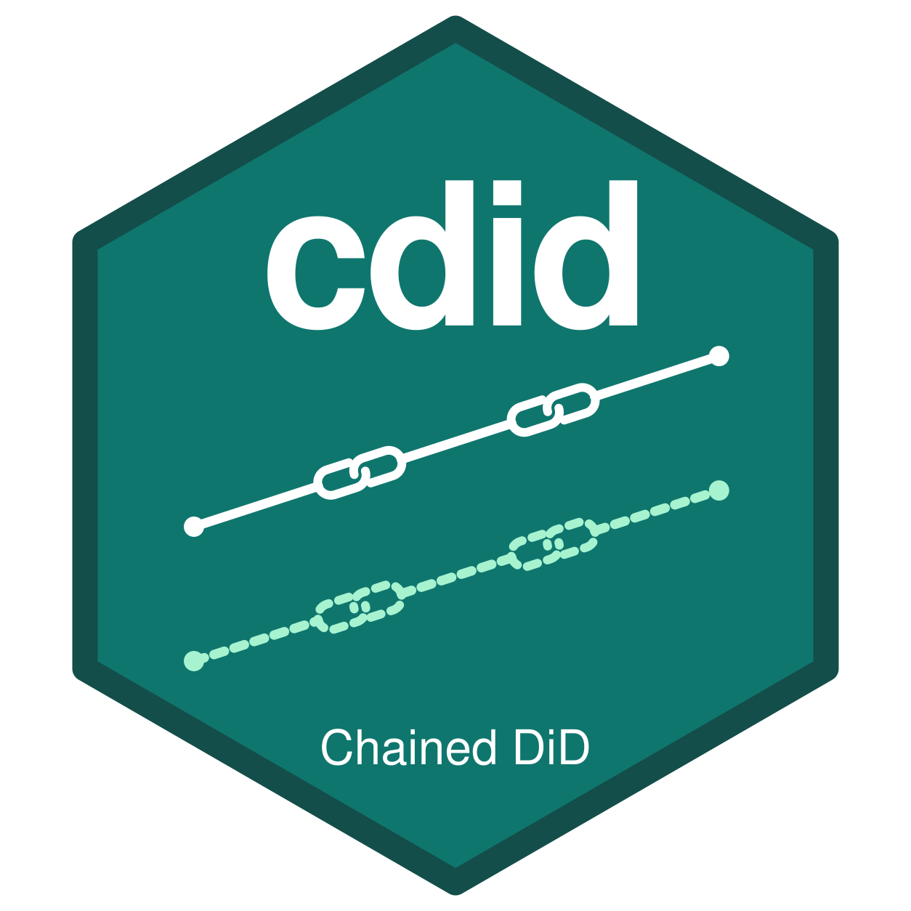

# cdid user guide 

`cdid` brings widely used difference-in-differences estimators into a common framework for complete and incomplete panels. It reproduces documented specifications of established methods and extends them with chained comparisons, observation weighting, change imputation and doubly robust corrections for selective missingness, by leveraging the chained difference-in-differences (chained DiD).

Work through a first chained difference-in-differences fit, then prepare your panel, choose comparisons and adjustments, and interpret the results. The [package overview](../README.md) has the installation commands and a runnable first example.

The guide describes `cdid` 1.0.0.1 for Stata. Output shown on the pages comes from recorded runs of the commands printed on the same page, with the seed given there. Analytical population values are labeled separately.

## Before you start

1. Install the package as described in [Installation](installation.md). Ordinary mode also needs `csdid` 2.0.2.
2. Have long data with one row per unit and date: a unit identifier, a numeric date, a numeric outcome with missing values kept as missing, and the treatment variable. For staggered adoption, the treatment variable holds each unit's first treatment date, with 0 for units never treated.
3. Start with the [worked fit](get-started.md). [Prepare your panel and unit table](help/prepare-data.md) gives the input checklist, and [Investigate missingness and data structure](help/investigate-missingness.md) shows how to inspect who is observed at each date and which comparisons have support.

Each page of the reading path ends with links to the previous and next steps.

## Reading path

The steps are numbered as on the pages themselves. Read Stage 1 in order. Later stages can be read when the decision arises.

### Stage 1. Make a first fit and understand what it estimates

| Step | Page | What you learn |
| --- | --- | --- |
| 1 | [Get started](get-started.md) | Estimation, replay, aggregation, plots, export and saved results on a simulated panel. |
| 2 | [Moving from did and csdid](from-did.md) | What stays familiar, how incomplete panels are treated, and why balanced results can differ between chained and ordinary mode. |
| 3 | [Incomplete panels](examples/incomplete-panels.md) | Which changes an observation pattern supplies and how chaining combines them. |
| 4 | [Identify effects when the observed units change composition](examples/identification.md) | When changes within units identify effects that comparisons of observed levels do not. |
| 5 | [How to compare precision](examples/precision.md) | Matched targets and assumptions, covariance, and what standard errors can show. |

### Stage 2. Prepare your data

| Step | Page | What you learn |
| --- | --- | --- |
| 6 | [Prepare your panel and unit table](help/prepare-data.md) | Identifiers, missing outcomes, the unit table `frame()`, changing covariates or weights, and [known reference covariate rows](help/prepare-data.md#add-a-known-reference-covariate-row) with `missingreference()`. |

### Stage 3. Adjust for treatment

| Step | Page | What you learn |
| --- | --- | --- |
| 7 | [Treatment adjustment](methods/treatment.md) | How IPW, OR and DR make a cohort comparable with its controls, and separate or pooled outcome regressions. |
| 8 | [Choose IPW, OR or DR in an incomplete panel](examples/treatment-choice.md) | The three treatment adjustments compared. |

### Stage 4. Handle missing outcomes

| Step | Page | What you learn |
| --- | --- | --- |
| 9 | [Handling missing outcomes](methods/missing-outcomes.md) | The study population, the assumption about missing outcomes and the three ways to adjust for them. |
| 10 | [Sampling information for the observation model](methods/sampling-information.md) | Advanced: fitting the observation model on part of the unit table. |
| 11 | [Choose an observation model](examples/observation-models.md) | Date or pair logits, and how many slopes they share. |
| 12 | [Impute actual changes](examples/change-imputation.md) | Observation weighting, change imputation and the augmented correction compared. |

### Stage 5. Choose the parallel trends assumption and how comparisons are combined

| Step | Page | What you learn |
| --- | --- | --- |
| 13 | [Parallel trends](methods/parallel-trends.md) | PT-post, PT-all, PT-ctrl and the separate reporting choice `baseperiod()`. |
| 14 | [Add PT-all restrictions](examples/pt-all-comparison.md) | What true and false PT-all restrictions change. |
| 15 | [GMM weighting and covariance regularization](methods/gmm.md) | How comparisons are combined and what covariance regularization does. |
| 16 | [Robustness](examples/robustness.md) | Which models must be correct for each combination of treatment adjustment and missing-outcome handling. |

### Stage 6. Inference, reference and troubleshooting

| Step | Page | What you learn |
| --- | --- | --- |
| 17 | [Inference](examples/inference.md) | Intervals, bands, clustering, aggregation and pretrend tests. |
| 18 | [Options](reference/options.md) | Every option with its default, accepted values and the estimators that accept it. |
| 19 | [Results](reference/results.md) | The stored results of every command, the uncertainty rules and the exported datasets. |
| 20 | [Diagnose errors and unavailable results](help/troubleshooting.md) | Refused requests, failed fits, unavailable effects and surprising results. |

### Stage 7. Chain across cohorts with different observation windows

| Step | Page | What you learn |
| --- | --- | --- |
| 21 | [Cross-pair chaining, control parallel trends and within-unit weighting](methods/cross-pair.md) | `crosspair` when a cohort and its controls share no date pair, `ptassumption(ctrl)`, `gmmweighting(within)`, and `cdid_chain` to see which comparisons identify an effect. |
| 22 | [Short pretreatment windows](examples/short-pretreatment-windows.md) | Staggered cohorts observed only a few dates before adoption, and how chaining links their windows. |

## Choose the treatment design

The reading path uses the cohort model: `gvar()` holds each unit's adoption date, treatment is absorbing, and effects may evolve with time since adoption. The switching model and the linear fixed-effects specification also support the treatment and missing-outcome adjustments of Stages 3 and 4.

| Design | Page | What distinguishes it |
| --- | --- | --- |
| Binary treatment that can stop and restart | [When treatment can stop and restart](methods/switching.md) | A static model without carryover: earlier treatment has no lingering effect beyond current status. Supply `dvar()`, the treatment status at every study date. The results hold effects at entry and exit and a switcher-weighted average. `estat` does not apply. |
| Linear cohort-by-date fixed effects | [Cohort-by-date fixed effects](methods/cohort-time-fe.md) | A linear specification with unit fixed effects and a common untreated calendar path. Supply `gvar()` and `preset(cohort_time_fe)`. |

Supplying both `gvar()` and `dvar()` is an error. Absorbing data supplied through `dvar()` still request the static model. The [options reference](reference/options.md) marks which options apply to each design.

## Compare with other software

- [Moving from did and csdid](from-did.md) explains chained versus ordinary mode and the added options.
- [Moving from R cdid](from-r-cdid.md) maps the arguments of R `cdid` 1.3.0.0 to Stata options and results.
- [Familiar DiD models for incomplete panels](comparisons.md) relates common specifications to chained estimation.
- [Estimate familiar DiD models with cdid](from-other-packages.md) gives the settings that reproduce `csdid`, the linear cohort-by-date regression, imputation and two-stage event studies, stepwise and cohort-chained DiD, and states which matches were run in Stata.
- [Cross-pair chaining](methods/cross-pair.md) describes the settings that reproduce a stacked cohort fixed-effects benchmark.

## Hands-on guide and do-files

The [hands-on guide](hands-on.md) follows the do-file [`cdid_hands_on.do`](../examples/cdid_hands_on.do), which simulates an incomplete staggered panel and runs every main workflow: estimation, missing-outcome corrections, weights, parallel trends, aggregation, pretrend tests, diagnostics, graphs, exports, saved results and common errors. [Custom estimators](custom-estimators.md) follows [`cdid_custom_estimators.do`](../examples/cdid_custom_estimators.do). `net get cdid` copies both do-files to the current folder. [Working with results](user-results.md) explains replay, storage, export and saved files, and [Performance](performance.md) reports measured computation times.

## Which page answers my question?

| Question | Where to look |
| --- | --- |
| An effect is reported as unavailable | [An effect is unavailable](help/troubleshooting.md#an-effect-is-unavailable) and `cdid_export, type(cells)`, which lists every cell with its reason. |
| A covariate is missing at a cohort's reference date | [Add a known reference covariate row](help/prepare-data.md#add-a-known-reference-covariate-row). The default `missingreference(exclude)` warns and restricts the affected cohort, and `missingreference(error)` stops and lists the inputs. |
| Should I use chained or ordinary mode on a balanced panel | [Moving from did and csdid](from-did.md#why-balanced-results-can-differ). |
| My treatment stops or restarts | [When treatment can stop and restart](methods/switching.md). |
| My cohort and its controls never share a date pair | [Cross-pair chaining](methods/cross-pair.md) and [Short pretreatment windows](examples/short-pretreatment-windows.md), with `cdid_chain` to inspect the comparisons that identify each effect. |
| I want the `cdid` settings that reproduce another DiD command | [Estimate familiar DiD models with cdid](from-other-packages.md). |
| Which models must be correct for my choice of adjustments | [Robustness](examples/robustness.md) and [Handling missing outcomes](methods/missing-outcomes.md). |
| I want to see the fitted equations and coefficients | Specify `keepnuisance` and type `cdid_nuisance`; see `help cdid_nuisance`. |
| The pretrend test is unavailable | [Pretrend tests are unavailable](help/troubleshooting.md#pretrend-tests-are-unavailable). |
| A command stopped with an error | [Diagnose errors](help/troubleshooting.md). |

## Terms used in this guide

| Term | Meaning |
| --- | --- |
| Study population | The population whose treatment effects the analysis describes. |
| Unit table | One row per study unit, supplied through `frame()`, including units with one or no observed outcomes. Without `frame()`, the units present in the data form it. |
| Treatment cohort | Units first treated in the same period. `gvar()` holds that period, and 0 marks units never treated. |
| Reference date | The last study date before a cohort's treatment date, less the anticipation periods. Covariates that vary over time are read there. |
| Switchers and stayers | With `dvar()`, units whose treatment status changes at a date and units with the same prior status that keep it. Stayers are the comparison for that transition. |
| Units observed at both dates | The units whose outcomes are observed at both dates of a comparison. Only they contribute that change. |
| Treatment adjustment | How each cohort is made comparable with its controls: IPW, OR or DR, chosen with `method()`. |
| Handling missing outcomes | The assumption made about missing outcomes and the way the package adjusts for them, chosen with the options that begin with `sel` and with `imppooling()`. |
| PT-post, PT-ctrl and PT-all | Parallel trends from each cohort's reference period onward, the same with common earlier trends among the clean control cohorts, and the same with common earlier trends for all cohorts from a chosen start date. |

## Questions and bug reports

Use [Issues](https://github.com/dvbn/cdid-stata/issues) for questions about using the package or choosing a method and for reproducible bugs. Include the package version, the Stata version and a self-contained example.
