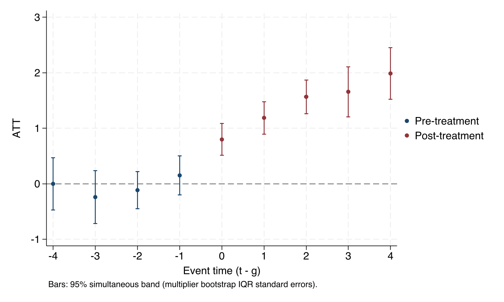
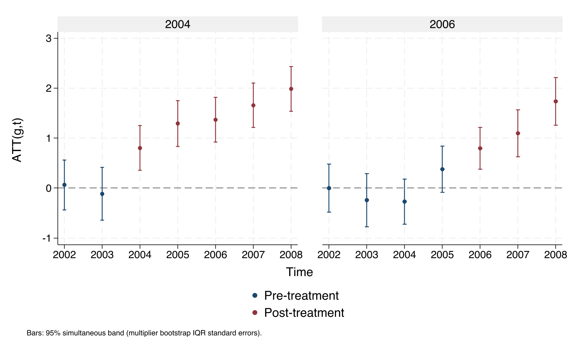

# Get started: estimate effects in an incomplete panel

This page simulates a staggered panel in which one outcome in five is missing, estimates the group-time effects in chained mode and then uses the main postestimation commands: replay, the four `estat` aggregations, `cdid_plot`, `cdid_export`, and saved results with `cdid_load`. The output was produced by `cdid` 1.0.0.0 in Stata 19.5 by running the commands of this page in order. It is one simulated sample and says nothing about coverage in repeated samples.

## The question

About 60 percent of 600 units start a treatment in 2004 or 2006 and stay treated; the others are never treated. Outcomes are observed from 2001 to 2008, but each outcome is missing with probability 0.2, independently of everything else. What is the average effect of the treatment on each cohort at each date, and how do the effects summarize?

## Prepare the panel

```stata
clear
set seed 20261116
set obs 600
generate id = _n
generate G = cond(runiform() < .4, 0, cond(runiform() < .5, 2004, 2006))
generate x = rnormal()
expand 8
bysort id: generate year = 2000 + _n
generate y = x + .2*(year - 2000) + (G > 0 & year >= G)*(1 + .25*(year - G)) + rnormal()
replace y = . if runiform() < .2
```

| Variable | Meaning | Option |
| --- | --- | --- |
| `y` | outcome, missing for about one row in five | `depvar` |
| `year` | date, 2001 to 2008 | `time()` |
| `id` | unit identifier | `ivar()` |
| `G` | first treatment date, 0 for units never treated | `gvar()` |
| `x` | covariate, constant within unit | `indepvars` |

Every unit keeps a row at every date, with `y` missing where the outcome is not observed. The units in the data are the study population, so no unit table (`frame()`) is needed. The cohort sizes and the number of observed outcomes per unit:

```stata
tabulate G if year == 2001
egen n_obs = total(!missing(y)), by(id)
tabulate n_obs if year == 2001
```

```text
          G |      Freq.     Percent        Cum.
------------+-----------------------------------
          0 |        236       39.33       39.33
       2004 |        168       28.00       67.33
       2006 |        196       32.67      100.00
------------+-----------------------------------
      Total |        600      100.00
```

```text
      n_obs |      Freq.     Percent        Cum.
------------+-----------------------------------
          3 |          3        0.50        0.50
          4 |         30        5.00        5.50
          5 |         87       14.50       20.00
          6 |        169       28.17       48.17
          7 |        213       35.50       83.67
          8 |         98       16.33      100.00
------------+-----------------------------------
      Total |        600      100.00
```

Only 98 units are observed at all eight dates. Every unit is observed at least three times, so every unit contributes changes.

The simulated effect is $1 + 0.25\,(t - g)$ from the treatment date onward and zero before; the untreated trend, $0.2$ per year, is shared by all units:

| Quantity | Simulated truth |
| --- | --- |
| Cells before treatment | 0 |
| ATT(2004, 2004), ATT(2004, 2005), ..., ATT(2004, 2008) | 1.00, 1.25, 1.50, 1.75, 2.00 |
| ATT(2006, 2006), ATT(2006, 2007), ATT(2006, 2008) | 1.00, 1.25, 1.50 |

## Assumptions for this example

- **Comparison group.** Units never treated (`controlgroup(nevertreated)`, the default).
- **No anticipation.** Units do not react before their treatment date (`anticipation(0)`). The reference date of cohort 2004 is 2003, that of cohort 2006 is 2005.
- **Parallel trends from the reference date (PT-post).** Without treatment, the mean outcome of each cohort would have changed from its reference date onward like that of the units never treated. The simulation satisfies this by construction.
- **Missing outcomes.** Under `selection(none)`, the default, the units observed at both dates of a comparison must represent their cohort's mean change over that pair. Here outcomes are missing completely at random, which is sufficient.
- **Overlap.** Treatment does not depend on `x`, so every cohort overlaps with the controls.

## Estimate the effects

```stata
cdid y x, ivar(id) time(year) gvar(G) gmmweighting(optimal)
```

This example specifies `gmmweighting(optimal)` to reproduce the recorded output. Omit that option to use the current built-in cohort default, `within`. The other settings use their defaults, including doubly robust treatment adjustment (`method(dr)`) with `x` as covariate, never-treated controls, PT-post, a varying base period for the pretreatment cells, and 1000 multiplier-bootstrap draws with a 95% simultaneous band (`bstrap(1) cband(1) biters(1000) level(95)`). The draws use Stata's random-number stream, so the `set seed` above makes them reproducible.

| Option | Value in this example | Definition |
| --- | --- | --- |
| `ivar()`, `time()`, `gvar()` | `id`, `year`, `G` | [Data, timing and comparison group](reference/options.md#data-timing-and-comparison-group) |
| `controlgroup()` | `nevertreated` (default) | [Data, timing and comparison group](reference/options.md#data-timing-and-comparison-group) |
| `method()` | `dr` (default) | [Treatment adjustment](reference/options.md#treatment-adjustment) |
| `ptassumption()`, `baseperiod()` | `post`, `varying` (defaults) | [Parallel trends and reporting](reference/options.md#parallel-trends-and-reporting) |
| `gmmweighting()` | `optimal` | [GMM weighting](methods/gmm.md) |
| `bstrap()`, `cband()`, `biters()`, `level()` | defaults | [Inference](reference/options.md#inference) |

## Read the result

```text
Chained difference-in-differences            Number of units       =       600
Method: doubly robust (dr)                   Number of cells       =        14
GMM weighting: optimal
Control group: never treated; base period: varying
------------------------------------------------------------------------------
   Group     Time  Role             ATT  Std. err.       [95% simult. band]
------------------------------------------------------------------------------
    2004     2002  pre        .06465903   .1813182    -.4339139    .5632319
    2004     2003  pre        -.1160236   .1925284    -.6454215    .4133743
    2004     2004  post        .8007932   .1632064     .3520225    1.249564
    2004     2005  post        1.292404    .167314     .8323385    1.752469
    2004     2006  post         1.36689   .1629828     .9187344    1.815046
    2004     2007  post        1.656024   .1620924     1.210316    2.101731
    2004     2008  post        1.986083   .1628001      1.53843    2.433736
    2006     2002  pre        -.0010518    .174538    -.4809813    .4788777
    2006     2003  pre        -.2412746   .1938725    -.7743684    .2918193
    2006     2004  pre        -.2701289   .1642154    -.7216741    .1814164
    2006     2005  pre         .3776257   .1680423   -.08444252    .8396939
    2006     2006  post        .7959092   .1510761     .3804932    1.211325
    2006     2007  post        1.096312   .1698427     .6292929     1.56333
    2006     2008  post        1.734893   .1738765     1.256783    2.213004
------------------------------------------------------------------------------
Std. err.: multiplier bootstrap (interquartile range of 1000 draws); simultaneous 95% band over
      the available cells. e(V) holds the analytic covariance.
Pretrend Wald test (pre-treatment cells): chi2(6) = 9.89, Prob > chi2 = 0.1296
```

Each row is a cell: the cohort (`Group`), the date (`Time`) and its role. `post` cells are the treatment effects ATT(g,t). `pre` cells compare each pretreatment date with the preceding date, because the base period is varying; they describe the trends of the cohort and its controls before treatment. `Lower` and `Upper` bound the 95% simultaneous band over the reported cells. The last line tests jointly that the pretreatment cells are zero; failure to reject does not establish parallel trends.

Typing `cdid` alone redisplays the current results. The table reports the available cells; `cdid_export, type(cells)` writes every cell with its availability and, for an unavailable cell, the reason. `e(b)` holds the available estimates and `e(coef_map)` the cell of each one. `e(V)` is the analytical covariance, while `e(se)` and `e(ci)` hold the reported bootstrap standard errors and band; [Results](reference/results.md#uncertainty) explains the difference.

## Aggregate the effects

`estat` summarizes the stored cells without refitting. It replaces the results in `e()` with the aggregation, so store the fit first if you want to return to it:

```stata
estimates store fit
estat simple
estat group
estat calendar
estat dynamic
```

`estat simple` averages all post-treatment cells, weighting each cohort by its share of the treated units:

```text
Chained difference-in-differences            Number of units       =       600
Method: doubly robust (dr)
GMM weighting: optimal
Control group: never treated; base period: varying
Aggregation: simple (average effect over all post-treatment cells)
------------------------------------------------------------------------------
                            ATT  Std. err.     [95% conf. interval]
------------------------------------------------------------------------------
Overall                1.333391  .08372642     1.169291    1.497492
------------------------------------------------------------------------------
Std. err.: multiplier bootstrap (interquartile range of 1000 draws); pointwise 95% intervals. e(V)
      holds the analytic covariance.
Pretrend Wald test (pre-treatment cells): chi2(6) = 9.89, Prob > chi2 = 0.1296
```

`estat dynamic` averages the cells by time since adoption, an event study:

```text
Chained difference-in-differences            Number of units       =       600
Method: doubly robust (dr)                   Number of event times =         9
GMM weighting: optimal
Control group: never treated; base period: varying
Aggregation: dynamic
------------------------------------------------------------------------------
Event time                  ATT  Std. err.       [95% simult. band]
------------------------------------------------------------------------------
Overall                1.438426  .08863714     1.264701    1.612152
------------------------------------------------------------------------------
                  -4  -.0010518   .1718845     -.472572    .4704684
                  -3  -.2412746   .1740801    -.7188177    .2362686
                  -2  -.1156114   .1215034    -.4489241    .2177013
                  -1   .1497876   .1288909     -.203791    .5033661
                   0   .7981633   .1048659     .5104911    1.085836
                   1   1.186816   .1061597     .8955944    1.478037
                   2   1.565046   .1112072     1.259978    1.870114
                   3   1.656024   .1641359      1.20576    2.106288
                   4   1.986083    .168826     1.522953    2.449213
------------------------------------------------------------------------------
Std. err.: multiplier bootstrap (interquartile range of 1000 draws); simultaneous 95% band over
      the available estimates. e(V) holds the analytic covariance.
The overall summary uses a pointwise interval.
Pretrend Wald test (pre-treatment cells): chi2(6) = 9.89, Prob > chi2 = 0.1296
```

`estat group` reports one average per cohort and `estat calendar` one per date. Each aggregation also reports an overall estimate with a pointwise interval, while the band covers the bins of that aggregation. Cohort shares are computed over the study population, including units with missing outcomes. Each call draws new bootstrap multipliers, so the standard errors of one aggregation vary slightly from one call to the next; the point estimates do not.

## Plot the effects

```stata
cdid_plot
estimates restore fit
cdid_plot
```

The first `cdid_plot` draws the current aggregation, the event study; after `estimates restore fit`, the second draws the group-time cells, one panel per cohort. Pretreatment and post-treatment estimates have different colors.





## Export tables and save results

```stata
estimates restore fit
cdid_export using gs_cells, type(cells) replace
tempfile saved
cdid y x, ivar(id) time(year) gvar(G) gmmweighting(optimal) saving(`saved')
cdid_load using `saved'
estat dynamic
```

`cdid_export` writes the cells to `gs_cells.dta`, one observation per cell; `type(aggregate)`, `type(units)`, `type(influence)` and `type(summary)` write the other tables. `saving()` writes the complete results, and `cdid_load` restores them without the data, so that `estat`, `cdid_plot` and `cdid_export` can be used later. The refit above draws new bootstrap multipliers, so its standard errors differ slightly from the first fit; its point estimates are identical. [Working with results](user-results.md) describes the files.

## Compare with ordinary DiD

```stata
cdid y x, ivar(id) time(year) gvar(G) mode(ordinary) bstrap(0) cband(0)
cdid y x, ivar(id) time(year) gvar(G) mode(ordinary) allowunbalanced bstrap(0) cband(0)
```

```text
note: 502 unit(s) not observed in every period were dropped; specify allowunbalanced to keep them

Difference-in-differences (ordinary mode)    Number of units       =        98
Method: doubly robust (dr)                   Number of cells       =        14
------------------------------------------------------------------------------
   Group     Time         ATT  Std. err.     [95% conf. interval]
------------------------------------------------------------------------------
    2004     2002    .2403625   .3337969    -.4138674    .8945923
    2004     2003    .2293042   .3689096    -.4937454    .9523538
    2004     2004    1.222235   .3302933     .5748716    1.869598
    2004     2005    1.389771   .3806285     .6437523    2.135789
    2004     2006    1.423924   .3667167     .7051727    2.142676
    2004     2007    1.663563   .3656605     .9468816    2.380244
    2004     2008    1.820988   .3537814     1.127589    2.514386
    2006     2002    .2990589   .3124318    -.3132962    .9114141
    2006     2003   -.1732519   .2895376    -.7407351    .3942313
    2006     2004    .1805558    .319025    -.4447217    .8058334
    2006     2005  -.05849817   .3982952    -.8391425    .7221462
    2006     2006    .8286732   .3198087     .2018598    1.455487
    2006     2007    .8867376   .3901815     .1219959    1.651479
    2006     2008    1.312276   .3725548     .5820823     2.04247
------------------------------------------------------------------------------
Std. err.: analytic; pointwise 95% intervals.
Pretrend Wald test (pre-treatment cells): chi2(6) = 2.96, Prob > chi2 = 0.8143
```

By default, ordinary mode keeps only the 98 units observed at every date, so its estimates are much less precise here. With `allowunbalanced`, it keeps all units and compares outcome levels with repeated cross-section estimators:

```text
Difference-in-differences (ordinary mode)    Number of units       =       600
Method: doubly robust (dr)                   Number of cells       =        14
------------------------------------------------------------------------------
   Group     Time         ATT  Std. err.     [95% conf. interval]
------------------------------------------------------------------------------
    2004     2002    .1079136   .1550416    -.1959623    .4117896
    2004     2003  -.02572416   .1568961    -.3332349    .2817865
    2004     2004    .6586376   .1565251     .3518539    .9654212
    2004     2005    1.273853   .1623038     .9557433    1.591963
    2004     2006    1.339856   .1559586     1.034182    1.645529
    2004     2007    1.672386   .1633037     1.352317    1.992455
    2004     2008    1.969221   .1548683     1.665685    2.272758
    2006     2002   .08135314   .1607196    -.2336515    .3963578
    2006     2003   -.1895846    .157225      -.49774    .1185707
    2006     2004   -.2084874   .1544496    -.5112031    .0942283
    2006     2005    .2765159   .1593149   -.03573552    .5887672
    2006     2006    .8229347   .1421898     .5442477    1.101622
    2006     2007    1.108006   .1632059     .7881285    1.427884
    2006     2008    1.738089   .1604108      1.42369    2.052489
------------------------------------------------------------------------------
Std. err.: analytic; pointwise 95% intervals.
Pretrend Wald test (pre-treatment cells): chi2(6) = 8.29, Prob > chi2 = 0.2176
```

Because outcomes are missing completely at random in this simulation, both chained and level comparisons are valid here, and the estimates are close. They need not be when observation depends on persistent differences between units; [Moving from did and csdid](from-did.md) explains when they should agree.

## Next steps

- [Moving from did and csdid](from-did.md) relates chained and ordinary estimation.
- [Prepare your panel and unit table](help/prepare-data.md) lists the input requirements.
- [Handling missing outcomes](methods/missing-outcomes.md) covers outcomes whose observation depends on covariates.

---

**Reading path, step 1 of 22** · Next: [Moving from did and csdid](from-did.md)

[Guide home](README.md) · [Package overview](../README.md)
